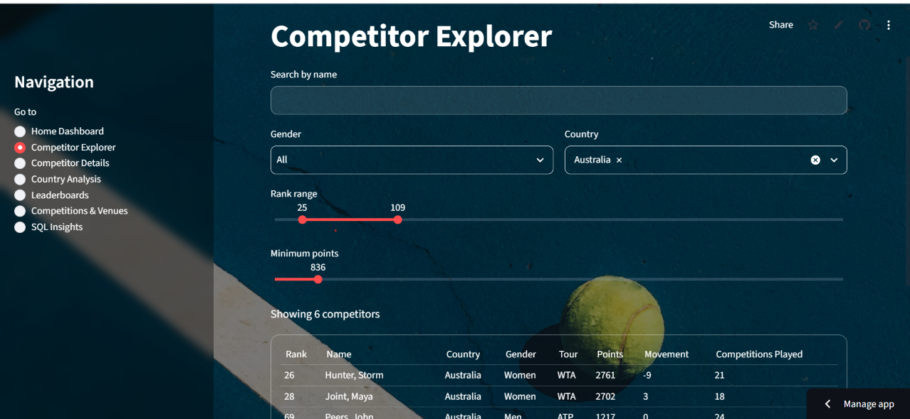
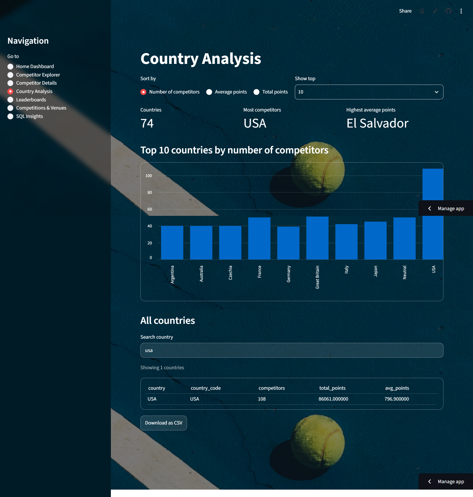
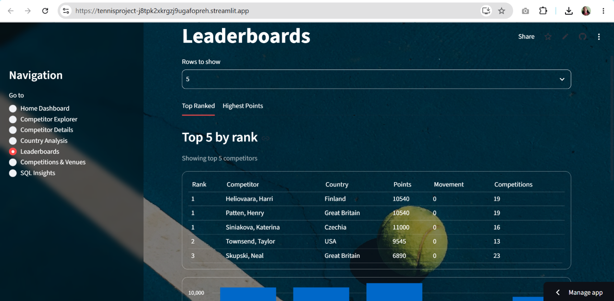
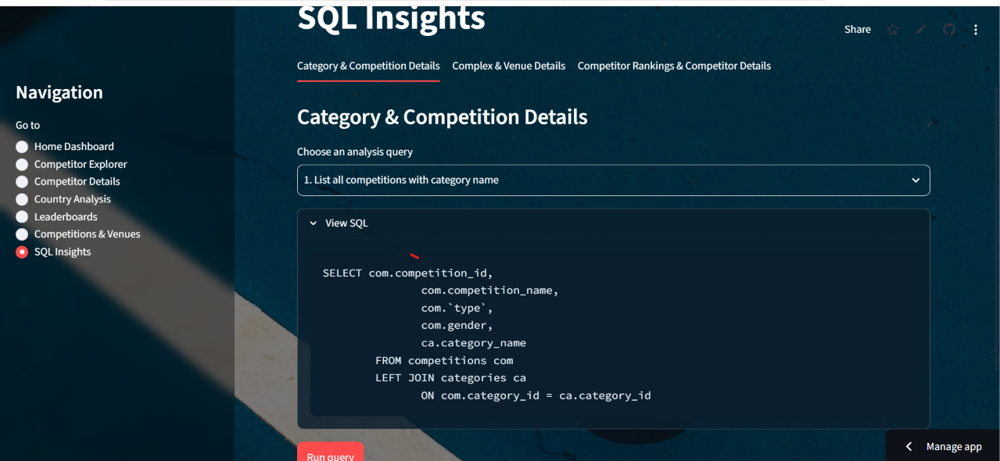

## Live Demo
[Open the app](https://tennisproject-j8tpk2xkrgzj9ugafopreh.streamlit.app/)

## Features
- **Home Dashboard**: total competitors, competitions, venues and countries, top countries, competition types, top 5 ranked competitors
- **Competitor Explorer**: search and filter doubles competitors
- **Competitor Details**: profile and ranking details for one competitor
- **Country Analysis**: competitors and points by country
- **Leaderboards**: full rankings list
- **Competitions & Venues**: browse competitions, complexes and venues
- **SQL Insights**: results of the SQL analysis queries

## Tech Stack
Python, Streamlit, Pandas, MySQL, SportRadar Tennis API

## Data Pipeline
1. `downloadjson.py`: collects competitions, complexes and doubles rankings from the SportRadar Tennis API (with delays to respect rate limits)
2. `preprocessing.py`: cleans the raw JSON
3. `Build_table.py`: builds CSV files for 6 tables (Categories, Competitions, Complexes, Venues, Competitors, Competitor_Rankings)
4. `Create_query.sql`: creates the tables with primary and foreign keys
5. `loadmysql.py`: loads the data into MySQL
6. `analysis_queries.sql`: SQL queries used for the insights page

## Project Structure
```text
tennis_project/
├── app/               # Streamlit app
├── data/              # raw JSON,CSV and clean files
├── screenshots/       # README images
├── Build_table.py
├── Create_query.sql
├── analysis_queries.sql
├── downloadjson.py
├── loadmysql.py
├── preprocessing.py
└── requirements.txt
```

## Run Locally
```bash
git clone https://github.com/dhamayanthidevik/tennis_project.git
cd tennis_project
pip install -r requirements.txt
streamlit run app/app.py
```
Set your database credentials and API key as environment variables or in `.streamlit/secrets.toml`. Never commit them.

## Author
Dhamayanthi Devi K
[LinkedIn](https://www.linkedin.com/in/dhamayanthi-devi-kumaramangalam-b31a1324b/) | [GitHub](https://github.com/dhamayanthidevik)# Tennis Rankings Explorer

A Streamlit app to explore doubles rankings, countries, competitions and venues, built on the SportRadar Tennis API with a MySQL backend.

## Screenshots

### Home Dashboard


### Competitor Explorer


### Country Analysis


### Leaderboards


### Competitions & Venues


### SQL Insights

